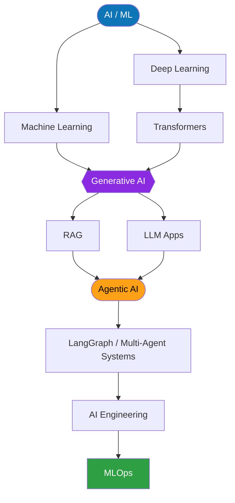

<!-- ===================== HEADER (animated wave) ===================== -->

  

<!-- ===================== TYPING ANIMATION ===================== -->

  

  
  
  

---

## 👨‍💻 About Me

- 🎓 B.Tech CSE @ IIIT Bhagalpur (2024 – 2028)
- 🤖 Applied AI/ML engineer building multi-agent RAG systems with guardrails
- 🧠 Deep learning models served through FastAPI
- 💼 Former Generative AI Intern @ DStarix Techno (Jul – Sep 2026)
- 🌐 Open to remote opportunities & internships
- 📫 Reach me: [princeverma87496@gmail.com](mailto:princeverma87496@gmail.com)
---

## 🏅 Highlights

- 🥇 **Adobe University Hackathon 2026** — Top 0.41% nationwide out of 3.1L+ registrations
- 🛒 **Amazon ML Challenge** — Ranked top 2,500 of 89,000+ participants
- 🏆 **Flipkart GRiD 8.0** — Semi-Finalist among 1.65L+ participants
- 💻 **470+ DSA problems** solved across LeetCode, GeeksforGeeks and CodeChef
---

## 💼 Experience

### 🧪 Generative AI Intern — DStarix Techno
**Remote** | Jul 2026 – Sep 2026

Contributed to **ResolveX**, a production AI customer support platform.

- 🤖 Engineered a **LangGraph multi-agent workflow** (intent router + 5 specialist agents) for automated triage, tool-based order lookups and human escalation via REST/WebSockets
- 📚 Architected a **hybrid RAG pipeline** over 7 policy documents using **Qdrant, Gemini embeddings and FlashRank reranking**, with a ≥ 0.75 confidence threshold to cut hallucinations and auto-escalate low-confidence queries to support tickets
- 🛡️ Built backend services with **FastAPI, Supabase PostgreSQL (7 tables)** and **9 production guardrails**, plus a **Redis cache (1-hour TTL)** to reduce repeated LLM calls
- 🚀 Deployed via **GitHub Actions CI/CD** to Render (backend) and Netlify (frontend), backed by a **230+ test pytest suite**

---

## 🧠 Technical Skills

  

| Category | Skills |
|---|---|
| **Languages** | `Python` · `C++` · `C` · `SQL` |
| **GenAI & LLM Engineering** | `LangGraph` · `LangChain` · `RAG` · `Hybrid Search` · `FlashRank` · `Guardrails` · `Tool Calling` · `Gemini API` |
| **ML & Data** | `NumPy` · `Pandas` · `Scikit-learn` · `CatBoost` · `RapidFuzz` · `TF-IDF` |
| **Deep Learning** | `PyTorch` · `Computer Vision` |
| **Vector Search & DBs** | `Qdrant` · `Embeddings` · `PostgreSQL (Supabase)` · `Redis` · `SQLite` |
| **Backend & Tools** | `FastAPI` · `WebSockets` · `Pydantic` · `pytest` · `Git/GitHub` · `Render` · `Netlify` · `Vercel` · `Streamlit` |

---

## 🚀 Featured Projects

### 🏢 Business Entity Resolution Pipeline — *Amazon ML Challenge (Sep 2026)*
`Python` · `CatBoost` · `RapidFuzz` · `scikit-learn` · `TF-IDF`

- Matched **1.73M reference businesses** against **~10M noisy records** across US, India and unseen-country (France) data — **ranked top 2,500 of 89,000+** (score **0.863**)
- Cut search space from **1.7 × 10¹³ pairs to ~3.5 × 10⁷ (>99.999%)** using country-partitioned, two-stage sparse TF-IDF blocking with **96.5% candidate recall**
- Engineered **18 pairwise features** and trained a precision-tuned **CatBoost** classifier; a dual-threshold F0.5 optimizer lifted precision from **0.897 → 0.952**
- Streamed inference in 20k-query chunks (peak RAM < 2 GB), passed the official validator with zero errors

### 🤖 ResolveX — *AI Customer Support Platform (DStarix)*
`LangGraph` · `Qdrant` · `Gemini` · `FlashRank` · `FastAPI` · `Redis` · `Supabase` · `GitHub Actions`

Multi-agent support system with intent routing, 5 specialist agents, hybrid RAG, confidence-based escalation, and 9 production guardrails.

### 👨‍👩‍👧 Kinship Verification — *Siamese Network (Jul 2026)*
`PyTorch` · `ResNet18` · `FastAPI` · `Computer Vision` · `Render`

- Siamese Network with a shared **ResNet18** backbone predicting biological relationships from facial images
- Trained on **Families In the Wild (FIW)**: 470 families, 2,318 individuals, 12,379 images, 330,358 balanced pairs
- Achieved **96.07% accuracy** and **99.35% ROC-AUC**
- Deployed a **FastAPI** inference service with a responsive web UI on Render

---

## 🏆 Coding & Problem Solving

| Platform | Achievement |
|----------|-------------|
| 🟠 **LeetCode** | **248 solved** (Easy 125 · Medium 118 · Hard 5) · Rating **1531** · Top 36.78% · 100 Days Badge 2026 |
| 🟣 **Codolio** | **474 questions solved** · **354 DSA** (Easy 189 · Medium 158 · Hard 7) |
| 📅 **Active Days** | **207** (Codolio) |
| 🔥 **Max Streak** | **50 days** (LeetCode) |
| 🏁 **Contests** | **38 attended** |
| ⭐ **CodeChef** | **1391** (max 1391) |
| ⭐ **CodeChef DSA** | **1497** (max 1497) |
| 🌍 **Codolio Global Rank** | **12284** |

🔗 [LeetCode](https://leetcode.com/u/prince765/) · [Codolio](https://codolio.com/profile/prince_verma73)
---

## 📈 GitHub Stats

  
  

  

  

---

## 🎬 Beyond Code — Video Editor & Cinematographer

> *When I'm not training models, I'm cutting footage and telling stories.*

**🎥 Lead — CINEMARA, Cinematography Club | IIIT Bhagalpur** *(Aug 2025 – Jul 2026)*

- ✂️ Led **30+ creators**, mentoring peers in video editing, cinematography and storytelling
- 📸 Ran **5+ workshops** on technical photography and creative content creation
- 🎞️ Co-Lead for media production at **ENYUGMA'26** — official photography & videography
---

## 🔭 Currently Working On

- 🧩 Production-grade **agentic AI** workflows with LangGraph
- 📚 Advanced **RAG** — hybrid search, reranking, evaluation
- 🛡️ LLM **guardrails** & reliability
- 🚢 MLOps and CI/CD for AI apps
- 💻 Data Structures & Algorithms

---

## 💡 Learning Roadmap

---

## 🌐 Connect With Me

  
  
  
  
  
  

  

  

